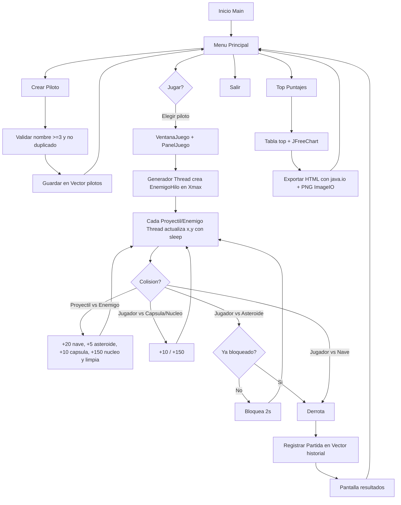

# Diagrama de Flujo - Quetzal Space Defender

**Estudiante:** Oscar Rene Monzon Ortiz - 202402543

## Flujo general (Mermaid)

## Flujo textual paso a paso
1. `Main` lanza `MenuPrincipal`.
2. Crear piloto valida y guarda en `Almacen.pilotos` (Vector).
3. Jugar pide elegir piloto y abre `VentanaJuego`.
4. `PanelJuego.iniciar` lanza generador + repintado.
5. Bucle: mover jugador (WASD/flechas), disparar (ESPACIO con cooldown), enemigos avanzan.
6. Colisiones sincronizadas definen puntaje, bloqueo 2s o derrota.
7. Al derrota se crea `Partida`, se guarda en `historial`, se muestra resultado.
8. Top ordena Vector con burbuja, dibuja JFreeChart y exporta HTML.

## Procesos principales
- Gestión pilotos: validación + Vector.
- Simulación combate: hilos + colisiones + sleep por dificultad.
- Mecánicas especiales: núcleo, asteroide, cápsula.
- Reportes: JFreeChart + FileWriter/PrintWriter + ImageIO.
