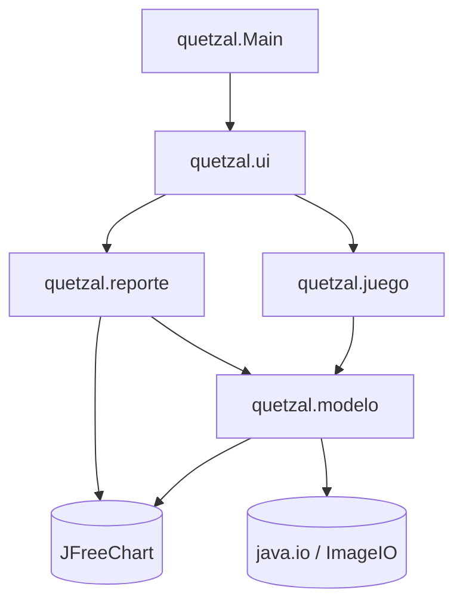
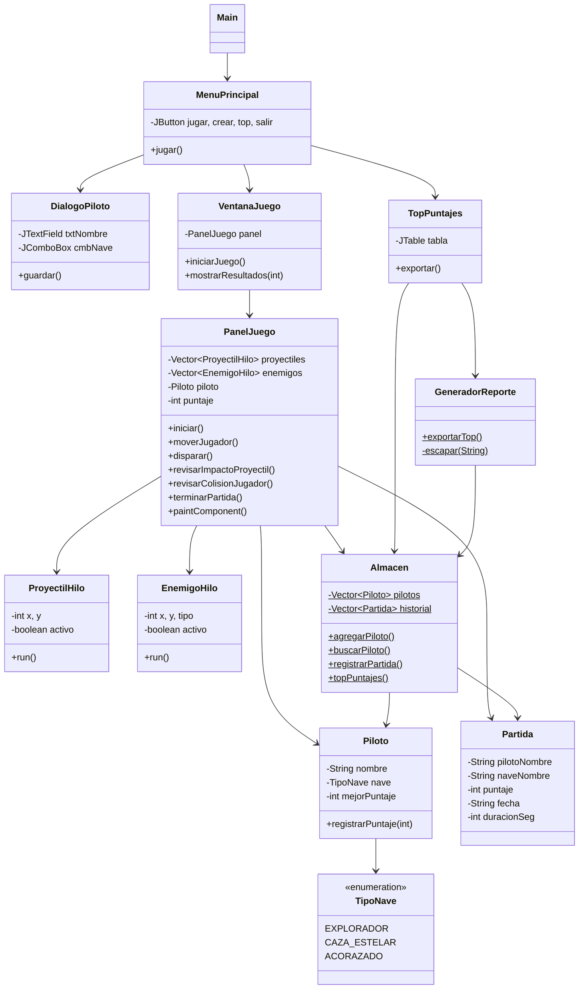
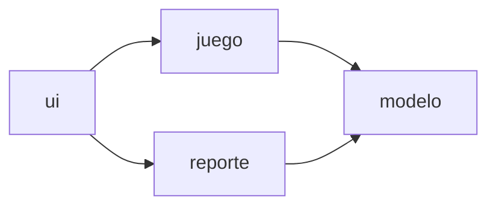

# Diagrama de Modulos - Quetzal Space Defender

**Estudiante:** Oscar Rene Monzon Ortiz - 202402543
**Practica 2 - IPC1E - 2S2026**

El proyecto se organiza en 4 paquetes (modulos) con una dependencia descendente:
la interfaz depende del juego, el juego depende del modelo, y los reportes leen el modelo.

## 1. Diagrama de paquetes (Mermaid)

## 2. Diagrama de clases por modulo

## 3. Descripcion de cada modulo

| Modulo (paquete) | Responsabilidad | Clases |
|---|---|---|
| `quetzal` | Arranque de la aplicacion | `Main` |
| `quetzal.modelo` | Entidades y persistencia en vectores | `Piloto`, `Partida`, `TipoNave`, `Almacen` |
| `quetzal.juego` | Simulacion, hilos, colisiones y dibujo | `PanelJuego`, `VentanaJuego`, `ProyectilHilo`, `EnemigoHilo` |
| `quetzal.ui` | Interfaz grafica | `MenuPrincipal`, `DialogoPiloto`, `TopPuntajes` |
| `quetzal.reporte` | Generacion de reportes | `GeneradorReporte` |

## 4. Flujo de dependencias (regla)

- La interfaz **nunca** es referenciada por el modelo (bajo acoplamiento).
- `Almacen` es el punto unico de acceso a los datos (patron tipo repositorio simple).
- La logica de negocio (puntajes, colisiones) vive en `PanelJuego`, no en la vista.
